  

### Full-stack engineer who ships complete, tested products, from the database to the app in your hand.

## ⚡ What I bring

- **Real-time systems.** Built a live analytics platform that streams data over WebSockets to a Next.js frontend, backed by FastAPI, PostgreSQL and Redis, with **1,600+ automated tests** running in CI.
- **One backend, four platforms.** Designed a single FastAPI service that feeds native apps in **Swift (iOS), Kotlin (Android) and C# (Windows)**, plus the web.
- **Software people can actually install.** Packaged a Python data app into a standalone Windows release (**v1.1.0**): no installer, no Python, no cloud, just unzip and run.
- **AI used responsibly.** My LLM features only phrase results the code has already computed, and the output is checked before anyone sees it. Numbers never come from a model.
- **Product thinking.** Auth, admin panels, data import and export, and live demos. I build the boring parts that make software usable, not just the core feature.

## 🛠 Stack

| Area | Tools |
|---|---|
| **Languages** | Python · TypeScript · JavaScript · Java · Swift · Kotlin · C# |
| **Backend** | FastAPI · REST · WebSockets · JWT auth · SQLAlchemy |
| **Frontend** | Next.js · React · Tailwind CSS · Recharts |
| **Data** | PostgreSQL · Redis · pandas · NumPy |
| **Ship it** | Docker · GitHub Actions · pytest · Windows packaging |

## 🚀 Featured work

| Project | What it is | Built with | Proof |
|---|---|---|---|
| **[Pit Wall](https://github.com/arjun-nair1090/Pitwall)** | Real-time sports analytics platform: live data feed, historical replay, strategy simulation and Monte Carlo forecasting | Next.js · FastAPI · Postgres · Redis · WebSockets | 1,600+ tests · CI · Docker |
| **[PurpleSector](https://github.com/arjun-nair1090/purplesector)** | Desktop telemetry app that ingests live UDP data from racing games and gives spoken, data-backed coaching, fully offline | Python · Streamlit · pandas · TTS | [v1.1.0 release](https://github.com/arjun-nair1090/purplesector/releases) |
| **[APEX](https://github.com/arjun-nair1090/apex-f1-widgets)** | Live home-screen widgets on three platforms that switch between countdown, live data and results on their own | Swift · Kotlin · C# · FastAPI | iOS · Android · Windows |
| **[FitRank](https://github.com/arjun-nair1090/FitRankPro)** | Workout tracker with accounts, analytics and imports of very large Apple Health exports, streamed in the browser | Java · PostgreSQL · JavaScript | [Live demo](https://arjun-nair1090.github.io/FitRankPro/) |
| **[Resonance](https://github.com/arjun-nair1090/Resonance)** | Music platform with a hybrid recommendation engine (content, collaborative and behavioural signals) | Next.js · FastAPI · Postgres · Redis | Docker Compose |
| **[TradeBot](https://github.com/arjun-nair1090/TradeBot)** | Trading CLI for the Binance Futures API with hand-written HMAC-SHA256 request signing and input validation | Python · REST | Binance Testnet |

<b>📸 Screenshots</b>

 

| Pit Wall | PurpleSector |
|---|---|
|  |  |
| **FitRank** | **APEX** |
|  |  |

 

**Open to full-time software engineering roles: backend, full-stack and real-time systems.**

