<picture>
  <source media="(prefers-color-scheme: dark)" srcset="assets/signal-dark.svg">
  
</picture>

I'm in my second year of a B.Tech in AI and machine learning at Atlas Skilltech University, with a minor in AI and data science from IIT Mandi. I like problems where the data is live and the answer has to be right.

I've done four internships so far. At EY I built LangChain agents that turn equipment manuals into maintenance knowledge bases, and RAG chatbots on top of them. At Sypha AI I built a dashboard that uses an LLM as a judge to rank models on accuracy. At Trezix I worked on ML for banking data. My paper on bias mitigation in machine learning was selected for publication by Springer.

### Things I've built

**[Pit Wall](https://github.com/arjun-nair1090/Pitwall)** is live F1 timing and race strategy for every Grand Prix since 2018. On a replay of Singapore 2026 it forecast 21 of 23 real pit stops to within one place. The language model only puts into words numbers the code has already worked out, and every sentence it writes is checked against the data before it's shown. The backend has more than 1,600 tests.

**[Jewlerify](https://jewlerify.vercel.app/)** is a jewellery marketplace where every piece carries a QR tag. Scan it and you see the purity, the weight, and a price broken down from the live gold rate. [Source](https://github.com/arjun-nair1090/buildershub).

**[CalTrack](https://github.com/arjun-nair1090/CalTrack)** turns a photo of your meal into a food diary entry. An EfficientNet-B2 I fine-tuned on Food-101 names the dish, right first time on 89.5% of the 25,250 test photos, and USDA data supplies the calories.

**[PurpleSector](https://github.com/arjun-nair1090/purplesector)** is a race engineer in your headset for the F1 games. It decodes 60 Hz telemetry for all 22 cars and tells you which corner cost you time before you reach the next one. It runs offline, and you can [download it](https://github.com/arjun-nair1090/purplesector/releases).

**[APEX](https://github.com/arjun-nair1090/apex-f1-widgets)** puts live F1 timing on your home screen, written natively for iOS, Android and Windows.

Smaller ones: [Resonance](https://github.com/arjun-nair1090/Resonance) recommends music, [FitRank Pro](https://arjun-nair1090.github.io/FitRankPro/) tracks workouts, and [TradeBot](https://github.com/arjun-nair1090/TradeBot) places Binance futures orders from the terminal.

Most of it is Python and TypeScript, with FastAPI, Next.js, PostgreSQL and Redis. I've also shipped Java, Swift, Kotlin and C#, and on the ML side I use PyTorch, LangChain, LangGraph and TensorFlow.

### Get in touch

I'm looking for software and AI/ML internships. Email me at [arjunnair3006@gmail.com](mailto:arjunnair3006@gmail.com), find me on [LinkedIn](https://www.linkedin.com/in/arjunnair3006/), or read [my resume](Arjun_Nair_Resume.pdf).
